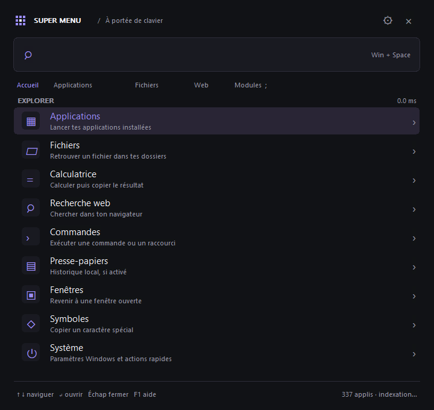
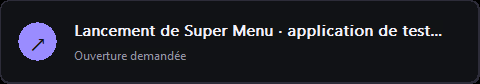
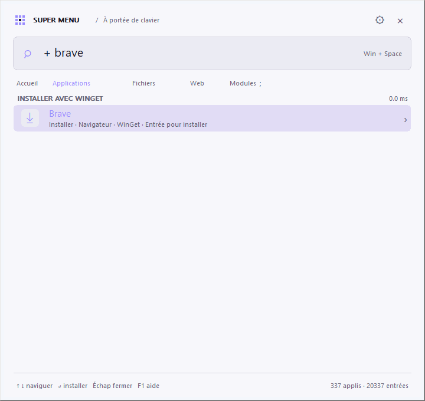
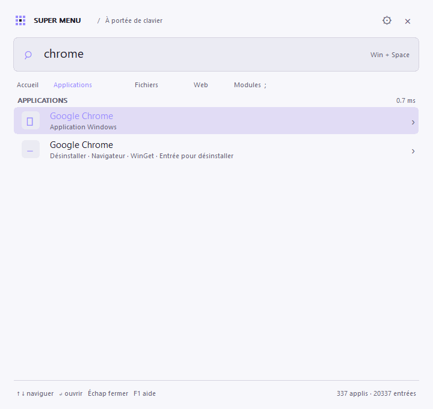
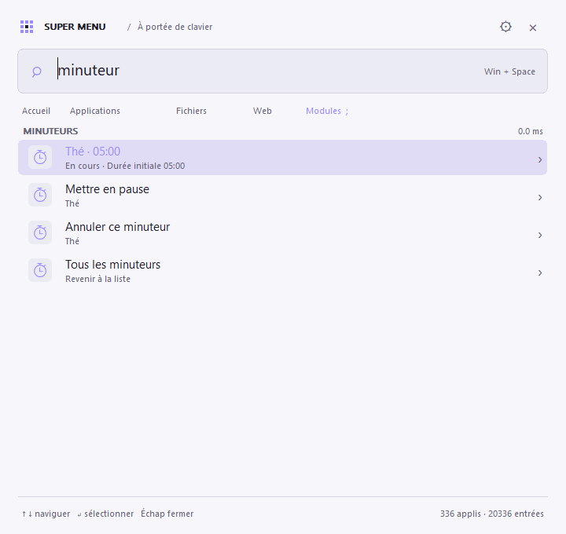

# Super Menu

[Découvrir l’application](https://roukmoute.github.io/SuperMenu/) · [Télécharger Super Menu](https://github.com/roukmoute/SuperMenu/releases)

Un lanceur et moteur de recherche **natif Windows**, écrit en Rust et Win32. Une fenêtre discrète, un raccourci global, une recherche au clavier. Le projet reprend l'idée des fournisseurs et de la personnalisation de [Walker](https://github.com/abenz1267/walker), avec une implémentation indépendante conçue pour Windows.



Windows 10 et 11, x64. L'exécutable autonome fait **environ 1,1 Mio**. Sa taille exacte peut varier selon la chaîne de compilation ; le [rapport de performances de la version 0.6.1](PERFORMANCE.md) détaille la réduction de taille de 27,8 %, la méthode et les compromis.

Le programme utilise les contrôles et API de Windows : aucun navigateur embarqué, aucune installation de .NET, aucun service distant nécessaire pour rechercher les applications ou fichiers. La recherche travaille sur un index en mémoire ; sa reconstruction s'effectue en arrière-plan. Un cache local accélère les démarrages suivants.

Les clés de recherche sont préparées pendant l'indexation ; la frappe filtre les candidats et sélectionne les meilleurs résultats sans trier tout le catalogue. Le menu garde ses fournisseurs fixes et ses textes traduits en mémoire, et réutilise sa mémoire de conversion UTF-16 ainsi que les ressources de dessin Windows. La restauration du cache utilise une vue de fichier en lecture seule ; sa sauvegarde écrit les éléments empruntés sans recopier l'index complet. Les mesures reproductibles du moteur, du cache et du menu sont décrites dans le [guide de tests](TESTING.md#mesurer-les-performances).

Les mesures comparent séparément la recherche sur 20 000 éléments, la restauration du cache et le dessin du menu. La recherche par défaut des applications et les opérations de cache progressent sur la machine testée ; les scénarios génériques et les latences d'affichage restent sensibles au profil de compilation et aux conditions du PC. Le [rapport détaillé](PERFORMANCE.md) publie aussi ces limites. Les **185 tests Rust**, le benchmark de cache facultatif et les **808 assertions Windows** passent.

## Langues

Au premier lancement, une petite fenêtre propose **Français** ou **English**. Le français est intégré. L’anglais est un fichier JSON d’environ **41 Ko**, téléchargé uniquement lors de sa première sélection et conservé dans `%LOCALAPPDATA%\SuperMenu\languages\en.json`. Les démarrages suivants utilisent ce cache, sans connexion. Si le téléchargement échoue, il reste possible de choisir le français.

Pour changer : **Paramètres → Langue → Changer…**, puis **Enregistrer**. Le fichier demandé est récupéré en arrière-plan s’il n’est pas déjà disponible. La traduction est appliquée sans redémarrage ; les noms des logiciels et les commandes ne sont pas modifiés. Aucune bibliothèque HTTP ou interface web supplémentaire n’est embarquée : le téléchargement utilise WinHTTP de Windows.

Les traductions sont modifiables et versionnées dans [`locales/`](locales/README.md).

## Utiliser

**À propos** ouvre une fenêtre native inspirée des écrans d'information système : grand titre Super Menu, matériel (processeur, carte graphique, écran, mémoire et disque système), édition et version Windows, durée de fonctionnement et informations de l'application. Elle reprend le thème et la couleur d'accent du menu. Accessible dans l'accueil, avec `; à propos`, dans le module Système (`! à propos`) ou depuis l'icône près de l'horloge. Les informations sont lues localement à l'ouverture ; leur collecte ne ralentit pas le démarrage du lanceur. Le bouton **GitHub** ouvre le dépôt du projet, et **Échap** ferme la fenêtre.

Télécharger l'archive depuis les [releases](https://github.com/roukmoute/SuperMenu/releases), l'extraire et lancer l'exécutable. Au premier lancement, le menu apparaît. Ensuite, **Win + Espace** affiche ou masque le menu. Une icône dans la zone de notification permet aussi de l'ouvrir et de quitter le programme.

Seul `supermenu.exe` est nécessaire pour utiliser l'application. Les autres fichiers de l'archive sont la documentation, la licence, un rapport de performances et un exemple de configuration. **Ctrl + Retour arrière** supprime le mot précédent ou la sélection dans la recherche ; **Ctrl + Z** annule cette suppression.

Les onglets et les modules de l'accueil affichent leur raccourci : **Applications @**, **Installer +**, **Désinstaller -**, **Fichiers /**, **Calculatrice =**, **Recherche web ?**, etc. Cliquer sur le module insère le préfixe ; on peut aussi le taper directement dans la recherche. **À propos** indique sa recherche `; À propos`.

Lors du lancement d'une application, un petit pop-in **« Lancement de [application]… »** apparaît immédiatement pendant **deux secondes**, en bas de l'écran du menu. Il reprend le thème et la couleur d'accent, laisse passer les clics et ne prend pas le focus. L'ouverture s'effectue en arrière-plan : le menu peut être rouvert avec Win + Espace pendant qu'une application démarre. Rouvrir le menu masque le pop-in ; la réponse de lancement ne referme pas ce menu.

Les validations répétées de la même application sont regroupées pendant ces deux secondes, ainsi que tant que Windows traite la demande. Une erreur retire cette protection pour permettre de réessayer et affiche le message de Windows. Le pop-in confirme une demande d'ouverture ; sa durée est fixe et ne dépend pas de l'apparition de la fenêtre de l'application.



Les applications installées affichent leurs **véritables icônes Windows**, extraites des exécutables, des raccourcis du menu Démarrer et des applications du Microsoft Store. Elles sont centrées dans leurs pastilles et adaptées à la résolution de l'écran. Leur chargement s'effectue en arrière-plan pour les résultats visibles ; un cache en mémoire limité à 256 icônes évite de les recharger pendant la frappe. **F5** actualise aussi ces icônes. Aucun logo n'est téléchargé, et aucun paquet d'icônes supplémentaire n'est nécessaire.

Si Windows ne fournit pas d'icône, le pictogramme générique reste visible. Les actions **Installer** et **Désinstaller** conservent leurs pictogrammes distincts ; un logiciel absent n'a pas nécessairement de ressource d'icône sur l'ordinateur. Les autres pictogrammes utilisent les polices système Segoe MDL2 Assets et Segoe UI Symbol.

La recherche sans préfixe recherche les **applications** : `edge` affiche d'abord les applications correspondantes, puis leur action **« Désinstaller »**. Un logiciel du catalogue intégré qui n'est pas installé apparaît avec le sous-titre **« Installer »**. Les fichiers et dossiers se recherchent explicitement avec `/`, par exemple `/ edge`. `@` limite la recherche aux applications à lancer ; `+` affiche uniquement les logiciels à installer et `-` ceux à désinstaller. Le menu d'accueil comporte aussi les entrées **Installer** et **Désinstaller**.

Un nom comme `steam` recherche des lettres contiguës, sans ramener `Stream Deck` ou `Telegram`. Les initiales des mots (`vsc` pour Visual Studio Code) et les abréviations courtes (`ffx` pour Firefox) restent acceptées. Les espaces entre les mots peuvent être omis, comme dans `firefox` pour « Fire Fox ». Les raccourcis nommés « Désinstaller… » ou « Uninstall… » sont exclus des applications à lancer, y compris dans l'ancien index en cache ; la désinstallation passe par les actions de gestion du logiciel correspondant.

Windows utilise déjà Win + Espace pour changer la langue de saisie. Super Menu lui donne la priorité lorsqu'il fonctionne. Choisir un autre raccourci dans les réglages si ce changement de langue doit rester accessible. Le fichier JSON permet aussi un raccourci personnalisé, par exemple `Ctrl+Alt+Space`.

| Saisie | Fournisseur |
| --- | --- |
| `firefox` | Application puis désinstallation, ou installation si Firefox est absent |
| `;` | Menu des fournisseurs |
| `minuteur 5m Thé` | Compte à rebours avec alerte |
| `@` | Applications déjà installées |
| `+ firefox` | Logiciels du catalogue à installer |
| `- firefox` | Logiciels installés à désinstaller |
| `/` | Fichiers et dossiers indexés |
| `= (15 + 5) * 3` | Calculatrice locale |
| `? rust windows` | Recherche Web dans le navigateur par défaut |
| `>` | Commandes personnalisées et exécution shell explicite |
| `:` | Historique du presse-papiers, si activé |
| `.` | Symboles à copier |
| `~` | Fenêtres ouvertes |
| `!` | Actions système |

Les flèches sélectionnent un résultat et **Entrée** l'active. **Échap** efface la recherche, puis masque le menu si elle est déjà vide. **Tab** ouvre le menu des fournisseurs. **Ctrl + Entrée** ouvre le dossier parent d'un fichier. **F1** affiche l'aide, **Ctrl + ,** ouvre les réglages et **F5** actualise l'index. Une commande shell ne s'exécute qu'après validation par Entrée. Les résultats de calcul, symboles et historique sont copiés dans le presse-papiers.

## Installer un logiciel

Saisir `firefox` : si Firefox n'est pas installé, le résultat indique **« Installer · Navigateur · WinGet »**. Sélectionner ce résultat et appuyer sur **Entrée** ouvre une console avec la progression du téléchargement et de l'installation. À la fin, Super Menu reconstruit l'index des applications ; le logiciel devient un résultat normal à lancer. La console se ferme automatiquement deux secondes après le résultat, y compris en cas d'erreur. Une demande d'autorisation Windows peut apparaître selon le logiciel.

Les propositions proviennent d'un petit catalogue intégré de **52 logiciels** : Firefox, Chrome, Brave, Vivaldi, 7-Zip, VLC, Spotify, Discord, Steam, VS Code, Git, PowerToys, LibreOffice, Obsidian et d'autres. `+` permet de parcourir les logiciels absents. Le catalogue ne couvre pas tous les paquets WinGet ; ses entrées sont définies dans [src/packages.rs](src/packages.rs). Le menu Démarrer, les applications Windows et le registre des désinstallations permettent de reconnaître les logiciels déjà présents, même installés autrement qu'avec WinGet. Cette détection s'effectue pendant l'indexation ; aucune requête réseau n'est effectuée pendant la frappe.

Cette fonction utilise [WinGet, fourni par Microsoft App Installer](https://learn.microsoft.com/en-us/windows/package-manager/winget/). S'il est indisponible, la console indique comment installer App Installer depuis le Microsoft Store. Le lanceur et sa recherche fonctionnent aussi sans WinGet. Super Menu ne télécharge aucun gestionnaire de paquets supplémentaire.

Une ancienne inscription de **Google Chrome** dans Windows ne masque plus son installation lorsque son chemin d'exécutable enregistré et les emplacements connus sont tous absents. Cette vérification se fait en arrière-plan, puis son résultat est conservé en mémoire. `chrome` et `+ chrome` proposent alors **Installer** ; `- chrome` garde l'accès explicite à la suppression de l'inscription restante. Lors de la validation, le helper vérifie à nouveau l'exécutable et réinstalle ce logiciel si nécessaire, même si WinGet le voit encore dans son inventaire. Une installation normale déjà présente reste inchangée, et une présence incertaine ne déclenche pas de réinstallation.



Une installation se déclenche uniquement par validation d'un résultat « Installer ». La commande cible l'identifiant exact du catalogue et la source `winget`, accepte les accords du paquet et de la source, et utilise `--no-upgrade` pour éviter de mettre à jour un logiciel déjà installé. Une vérification supplémentaire de sa présence précède l'installation. Les erreurs sont affichées dans la console ; un échec permet de réessayer. Une requête de recherche n'est jamais passée à un shell pour installer un logiciel.

## Désinstaller un logiciel

Choisir **Désinstaller** dans le menu, ou saisir `- chrome`, pour parcourir les logiciels installés. Avec une recherche simple comme `chrome`, le résultat à lancer reste en premier ; une ligne **« Désinstaller et nettoyer »** permet de retirer le logiciel directement depuis cette recherche.

**Entrée** affiche une seule confirmation pour la désinstallation et le nettoyage, avec **Non** sélectionné par défaut. Windows demande les droits administrateur si le logiciel est installé pour tout l'ordinateur, puis la console affiche la progression. WinGet utilise le mode silencieux du désinstallateur lorsqu'il est pris en charge. Après une réussite vérifiée, la recherche de résidus et leur nettoyage s'enchaînent sans confirmation supplémentaire. La console se ferme automatiquement deux secondes après le bilan ou l'erreur, sans attendre Entrée. Annuler la confirmation ou la demande administrateur ne lance aucun désinstallateur.

Les vingt derniers résultats des installations et désinstallations, le code d'erreur éventuel et les dernières lignes de la console sont conservés localement dans `%LOCALAPPDATA%\SuperMenu\software-reports`. **Clic droit sur l'icône de Super Menu → Dernières opérations de logiciels** ouvre ces rapports. Le mode de sélection rapide de la console est désactivé pour qu'un clic ne suspende pas la progression. La console reste ouverte pendant l'opération elle-même ; aucun délai ne coupe une installation ou une désinstallation en cours.

Les actions utilisent les identifiants exacts du catalogue ou les noms exacts du registre Windows pour les autres logiciels, y compris ceux installés autrement qu'avec WinGet. Les composants `SystemComponent` ou `NoRemove` sont exclus. Les variantes telles que Firefox ESR et VS Code Insiders gardent leur propre identité. Le helper vérifie à nouveau la présence du logiciel ; une cible inconnue, protégée ou ambiguë n'est pas supprimée. La commande n'utilise ni `--force`, ni `--purge`, ni `--all`.

Le nettoyage natif mémorise l'emplacement du programme avant sa désinstallation. Il vise les fichiers de programme attribuables au produit, ses raccourcis dont la cible est vérifiée, les caches reconnus et les traces techniques qui pointent vers ce programme. Il ne commence pas si la désinstallation échoue, si le logiciel est encore présent ou si sa disparition ne peut pas être vérifiée. Aucun scan n'est effectué pendant la frappe ou au démarrage du menu : ce travail reste dans le processus temporaire de désinstallation.

Le nettoyage **conserve les profils, réglages, sessions et sauvegardes personnelles**. Les dossiers partagés, liens et jonctions, emplacements système et résidus d'attribution incertaine sont laissés en place. La détection est ciblée, et ne prétend pas retrouver chaque trace de tous les logiciels. Les fichiers retirés vont dans la **Corbeille** ; les modifications du registre disposent d'une sauvegarde préalable. Ce mode conserve donc la possibilité de récupérer les fichiers ; vider la Corbeille reste une action séparée.

Dans un ancien dossier d'installation, seuls les binaires identifiés (`.exe`, `.dll`, `.pdb`, `.manifest`) sont recyclés : le dossier, ses ressources et les éventuels fichiers personnels restent en place. Les caches connus peuvent être retirés en entier. Les traces du registre sont limitées aux valeurs de lancement **Run** et **App Paths** qui désignent un exécutable exact du programme ; les clés de réglages, associations, services, pilotes, tâches planifiées, COM et MSI restent sous la responsabilité du désinstallateur officiel.

Les rapports se trouvent dans `%LOCALAPPDATA%\SuperMenu\uninstall-reports` et les sauvegardes du registre dans `%LOCALAPPDATA%\SuperMenu\uninstall-backups`. **Clic droit sur l'icône de Super Menu → Rapports de désinstallation** ouvre ce dossier. Le plan est sauvegardé avant le premier nettoyage, puis un bilan distinct détaille les résidus retirés ou conservés et leurs raisons. Les désinstallateurs externes restent responsables de leurs propres changements ; la conservation des données décrite ici s'applique au nettoyage de Super Menu.

Pour examiner un plan sans désinstaller ni nettoyer : `supermenu.exe --inspect-cleanup "id:Google.Chrome" --report plan.json`. Une cible hors catalogue utilise `name:Nom exact du registre`. Ce diagnostic ne lance aucun désinstallateur et ne demande pas d'élévation.



## Minuteurs

Choisir **Minuteur** dans l'accueil ou saisir `minuteur 5m` puis **Entrée**. Un aperçu affiche la durée avant de démarrer ; la frappe seule ne crée aucun minuteur. `timer` est aussi accepté. Les raccourcis proposés dans le module démarrent cinq, dix, vingt-cinq ou soixante minutes.

- `minuteur 5m Thé` : cinq minutes avec le nom « Thé ».
- `minuteur 90s` ou `minuteur 01:30` : une minute trente.
- `minuteur 1h 30m` ou `minuteur 1:30:00` : une heure trente.
- `minuteur 10` : dix minutes, l'unité par défaut.

Le compte à rebours apparaît dans la liste **Minuteur**. **Entrée** sur un minuteur ouvre ses actions : **Mettre en pause**, **Reprendre** et **Annuler**. **Échap** revient à la liste. Jusqu'à huit minuteurs peuvent coexister, avec une durée maximale de vingt-quatre heures.

À l'échéance, un court son Windows accompagne une alerte qui reste visible jusqu'à **Fermer**, sans prendre le focus. Plusieurs fins sont regroupées et peuvent aussi être acquittées individuellement dans le module. Les minuteurs continuent avec le menu masqué et pendant les dialogues de paramètres ou d'aide. Le temps passé en veille compte ; une échéance passée est signalée au réveil de Windows. L'application ne réveille pas l'ordinateur.

Les minuteurs restent en mémoire : **quitter Super Menu les annule**. Aucun service ni fichier supplémentaire n'est nécessaire. Sans minuteur en cours, aucune minuterie de compte à rebours n'est active.



## Réglages et index

Les réglages se trouvent dans `%LOCALAPPDATA%\SuperMenu\settings.json`. Le fichier [settings.example.json](settings.example.json) présente les champs disponibles : raccourci, thème, couleur d'accent, largeur du menu, nombre de résultats, commandes et dossiers à indexer. Les réglages de la fenêtre sont appliqués avec « Enregistrer ». Après une modification directe du JSON, quitter et relancer Super Menu.

`file_roots` contient uniquement les dossiers choisis. Les variables comme `%USERPROFILE%` sont acceptées. Les notifications natives de Windows surveillent ces racines et les menus Démarrer : une création, suppression ou modification déclenche une reconstruction en arrière-plan, après regroupement des événements rapprochés. Le programme attend les notifications du système quand rien ne change. **F5** permet aussi une actualisation manuelle.

L'indexeur ignore les fichiers système, les jonctions, les liens symboliques et les dossiers `.git`, `node_modules`, `bin` et `obj`. Il refuse les racines de disques, les partages et les lecteurs réseau. Le maximum configuré inclut fichiers et dossiers ; sa limite absolue est de 100 000 éléments. Chaque parcours est aussi limité à 4 096 dossiers, 100 000 entrées examinées, 24 niveaux et un budget de cinq secondes vérifié entre les opérations de disque. Un très grand arbre produit donc un index partiel : choisir des racines ciblées pour inclure les fichiers utiles.

`index.json` conserve localement les chemins des applications et fichiers indexés. `usage.json` conserve des identifiants SHA-256 et compteurs de lancement pour améliorer le classement ; il ne conserve ni requêtes ni texte du presse-papiers. Ces fichiers restent dans le profil Windows de l'utilisateur.

L'historique du presse-papiers est **désactivé par défaut**, limité au texte et conservé uniquement en mémoire. Les textes supérieurs à 32 768 caractères et les éléments marqués comme exclus par Windows sont ignorés. Désactiver l'option ou fermer le programme efface les entrées de Super Menu. Les formats d'exclusion sont ceux documentés par [Microsoft](https://learn.microsoft.com/en-us/windows/win32/dataxchg/clipboard-formats#cloud-clipboard-and-clipboard-history-formats).

## Compiler sous Windows

Installer Rust avec la chaîne **MSVC**, les outils C++ de Visual Studio Build Tools et **PowerShell 7**, puis exécuter depuis le dépôt :

```powershell
.\scripts\build.ps1 -Archive
```

Le script vérifie le formatage, Clippy et les tests, compile en Release, lance le benchmark et prépare `artifacts\SuperMenu-windows-x64.zip`. L'archive inclut le rapport `benchmark.txt`, même si l'exécutable graphique n'affiche rien dans la console. Le runtime C est intégré à l'exécutable. La compilation utilise les options Release du dépôt : optimisation, LTO et suppression des symboles de débogage. L'exécutable distribué n'est pas compressé au lancement.

Le [guide de tests](TESTING.md) décrit les suites Rust et Windows, les données fictives, les rapports et la façon d'ajouter une régression. `scripts/build.ps1` et GitHub Actions exécutent aussi les tests du vrai menu Windows avant de distribuer le binaire. Les rapports restent disponibles comme artefact **SuperMenu-test-results**, y compris après un échec.

Pour développer et mesurer séparément :

```powershell
.\scripts\test.ps1
cargo test --locked
cargo run --release --locked
cargo run --release --locked -- --benchmark
cargo run --release --locked -- --smoke-test --report smoke.json --snapshot menu.bmp
cargo run --release --locked -- --smoke-test --launch-feedback-test --report feedback.json
.\scripts\measure-performance.ps1 -Executable .\target\release\supermenu.exe -Report .\artifacts\performance.json
```

Le benchmark mesure le moteur de recherche sur des catalogues de test ; ses résultats dépendent de la machine et ne constituent pas une garantie de latence du raccourci ou du disque. `--smoke-test` ouvre brièvement le menu pour vérifier son démarrage et peut exporter un rapport ainsi qu'une capture BMP du menu. Avec `--launch-feedback-test`, il simule un lancement lent pour vérifier le pop-in et la réponse asynchrone sans ouvrir d'autre application. `--smoke-timeout-ms 120000`, uniquement avec `--smoke-test`, prolonge le diagnostic jusqu'à deux minutes (maximum cinq minutes), utile pour observer une opération longue. `--background` démarre sans afficher le menu, utile avec un raccourci placé dans `shell:startup`.

`measure-performance.ps1` mesure séparément le premier dessin du menu, sa mémoire, le dessin seul et la recherche suivie du dessin, sur une fixture isolée. Son rapport indique le binaire exact, les échantillons, les médianes et les p95. Ces mesures incluent les échanges Win32 entre processus et un dessin hors écran ; les lancements répétés utilisent généralement les caches Windows déjà chauds. Elles complètent le benchmark du moteur sur 20 000 éléments et n'imposent aucun seuil fixe dépendant du matériel.

GitHub Actions construit et vérifie le projet sur Windows à chaque pull request et mise à jour de `main`/`master`. Après une compilation réussie sur la branche principale, la version de `Cargo.toml` produit automatiquement une préversion téléchargeable, par exemple `v0.1.0`. Une version déjà publiée conserve son archive ; augmenter la version du paquet pour publier une nouvelle préversion. Un tag `v*` produit une release standard si cette version n'existe pas encore. Le code est sous [licence MIT](LICENSE) ; aucune portion du code de Walker n'a été copiée.
